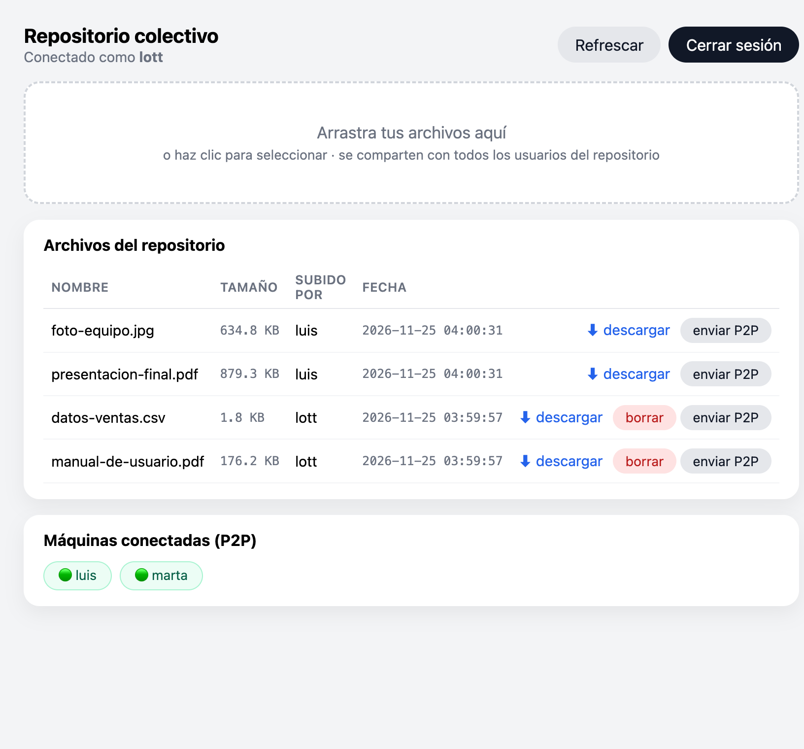
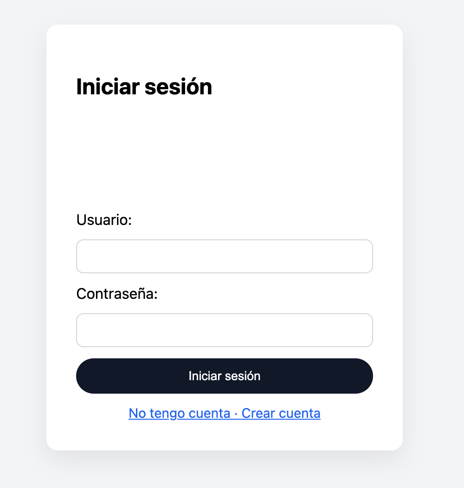
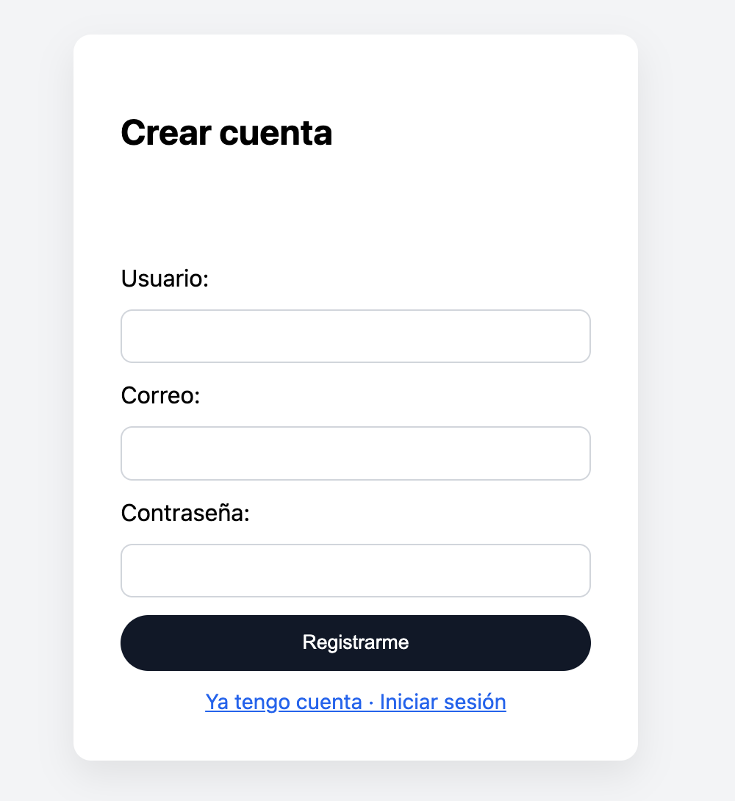
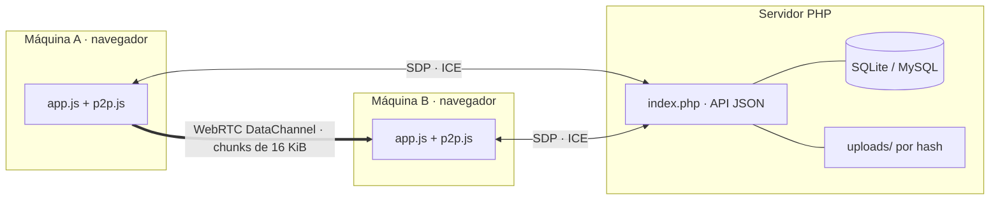

<div align="center">

# ☁️ mini-cloud

**Repositorio colectivo de archivos con intercambio P2P entre máquinas.**
Sube un archivo una vez, descárgalo desde cualquier equipo y envíalo directo de máquina a máquina —sin nubes de terceros y sin configurar nada.

[](https://github.com/Lott-Campuzano/mini-cloud/releases/tag/v1.0.0)
[](https://www.php.net/)
[](https://www.sqlite.org/)
[](https://webrtc.org/)
[](LICENSE)

Proyecto final de la materia de **Ingeniería de Software**.



</div>

---

## ¿Qué es mini-cloud?

mini-cloud es una nube privada mínima: un servidor PHP con una base de datos y una carpeta de archivos, más un cliente web que convierte a cada navegador en un nodo de la red. Los archivos viven de forma permanente en el repositorio (visibles para todos los usuarios) y, además, pueden viajar **directo de una máquina a otra** por WebRTC, en chunks y con verificación de integridad, al estilo de un cliente torrent.

No necesita frameworks, ni Composer obligatorio, ni servicios externos: con PHP 8 arranca en segundos.

## Funciones principales

### 📂 Repositorio colectivo con permanencia

- **Un solo repositorio para todos**: cada usuario autenticado ve la lista completa de archivos, quién los subió y cuándo.
- **Permanencia real**: el catálogo vive en la base de datos, no en el navegador. Al cambiar de equipo o cerrar sesión, todo sigue ahí.
- **Almacenamiento por contenido (content-addressed)**: cada archivo se guarda en `uploads/` con su hash **SHA-256** como nombre. Si dos personas suben el mismo contenido, solo existe una copia en disco.
- **Subida múltiple** arrastrando y soltando o con el selector de archivos, con avisos de progreso y errores.
- **Descarga por hash con el nombre original** del archivo.
- **Borrado seguro**: únicamente quien subió un archivo puede eliminarlo.
- **Cero configuración**: SQLite se crea sola en `data/` al primer arranque y `uploads/` se genera automáticamente.

### 🔁 Intercambio P2P tipo torrent (WebRTC)

- **Envío directo entre máquinas**: el archivo se transmite por un `RTCDataChannel`, sin pasar por el servidor.
- **Transferencias en chunks de 16 KiB** con control de flujo (máximo 1 MiB en vuelo) y barra de progreso en tiempo real.
- **Verificación SHA-256 doble**: el receptor comprueba el hash al reconstruir el archivo y el servidor lo vuelve a comprobar en `guardar.php` antes de aceptarlo.
- **Efecto swarm**: el archivo recibido se registra en el repositorio y desde ese momento cualquier máquina puede descargarlo o reenviarlo.
- **Panel de máquinas conectadas**: presencia con latidos cada 20 s; al elegir «enviar P2P» se muestra el destino disponible.
- **Señalización sin servicios extra**: las ofertas SDP y los candidatos ICE viajan por `senalizar.php`, un buzón respaldado en la propia base de datos.

### 🔐 Cuentas y seguridad

- Registro con `password_hash` (bcrypt) y login en **dos pasos**: contraseña + token de un solo uso de 64 caracteres hexadecimales.
- El token se envía por **correo SMTP** si configuras las variables de entorno; si no, se muestra en pantalla para uso local.
- **Protección CSRF** en el paso de verificación y **consultas preparadas** en todas las operaciones con la base de datos.
- **Límite de intentos**: 5 fallos por usuario y 10 por IP, con bloqueo automático de 10 minutos.
- Rutas y nombres saneados: los archivos solo se resuelven a partir de un hash SHA-256 válido y la descarga se sirve con `X-Content-Type-Options: nosniff`.
- Credenciales **solo por variables de entorno**, nunca en el código.

### ⚙️ Infraestructura sencilla

- **PHP 8.1+** con `pdo_sqlite` (viene incluido en la mayoría de instalaciones).
- **SQLite por defecto**, **MySQL opcional** con tres variables de entorno.
- **JavaScript puro**, sin build ni dependencias de frontend.
- Interfaz adaptable, con arrastrar y soltar, toasts y panel de transferencias.

## Capturas

| Iniciar sesión | Crear cuenta |
|:---:|:---:|
|  |  |

<p align="center">
  
  <br>
  <em>Repositorio colectivo: archivos de varios usuarios y máquinas en línea listas para recibir por P2P.</em>
</p>

## Cómo funciona



1. **Subida**: `carga.php` calcula el SHA-256, guarda el contenido en `uploads/<hash>` y registra nombre, tamaño, autor y fecha en la tabla `archivos`.
2. **Presencia**: cada página abierta manda un latido cada 20 s a `senalizar.php`; las demás ven quién está en línea.
3. **Envío P2P**: al pulsar «enviar P2P», la máquina emisora descarga el archivo del servidor y abre un canal WebRTC con la máquina destino. La oferta, la respuesta y los candidatos ICE se intercambian a través de la base de datos.
4. **Recepción**: el receptor reconstruye el archivo, verifica que el hash coincida y lo envía a `guardar.php`, que valida de nuevo y lo incorpora al repositorio para todos.

## Puesta en marcha

### Requisitos

- PHP **8.1 o superior** con `pdo_sqlite` (o `pdo_mysql` si usas MySQL) y sesiones habilitadas.
- Un navegador moderno con WebRTC (Chrome, Edge, Firefox o Safari recientes).

```bash
git clone https://github.com/Lott-Campuzano/mini-cloud.git
cd mini-cloud
php -S localhost:8000
```

Abre <http://localhost:8000/>: la base de datos SQLite y la carpeta de archivos se crean solas en el primer arranque.

> `php -S` es ideal para desarrollo y para la red local. Para producción usa Apache o Nginx con PHP-FPM.

### Compartir entre máquinas de la red local

En la máquina que hace de servidor:

```bash
php -S 0.0.0.0:8000
```

Y en las demás abre `http://IP-DE-LA-MAQUINA:8000/`, cada una con su propio usuario.

### Usar la aplicación

1. **Crea una cuenta** en «Crear cuenta».
2. **Inicia sesión**: introduce tu contraseña y luego el token que aparece en pantalla (o en tu correo).
3. **Sube archivos** arrastrándolos al área punteada.
4. **Comparte por P2P**: si hay otra máquina conectada, pulsa «enviar P2P» en la fila del archivo; el receptor verifica el hash y el archivo aparece en su repositorio.
5. **Descarga o borra**: tú puedes borrar tus archivos; todos pueden descargarlos.

### Probar el P2P en una sola computadora

Abre la aplicación en dos navegadores distintos (por ejemplo Chrome y Safari, o una ventana de incógnito) e inicia sesión con usuarios diferentes. Se verán en «Máquinas conectadas»; envía un archivo por P2P y comprueba que el receptor lo recibe y lo registra.

## Estructura del proyecto

```
mini-cloud/
├── index.php          Repositorio: lista, subida, descarga, borrado y P2P
├── login.php          Formulario de inicio de sesión
├── register.php       Formulario de registro
├── verificar.php      Segundo paso: token de acceso
├── process.php        Login en dos pasos, CSRF y límites de intentos
├── sign.php           Alta de cuentas
├── config.php         Configuración, PDO, tablas y utilidades
├── carga.php          Subida: guarda por hash y registra en la BD
├── listar.php         Lista completa del repositorio (JSON)
├── descargar.php      Descarga por hash con el nombre original
├── borrado.php        Borrado (solo el autor del archivo)
├── guardar.php        Registro de archivos recibidos por P2P
├── senalizar.php      Señalización WebRTC y presencia
├── logout.php         Cierre de sesión
├── assets/
│   ├── app.js         Interfaz del repositorio
│   └── p2p.js         Motor WebRTC: chunks, hash, swarm
├── docs/capturas/     Capturas usadas en este README
├── data/              Base de datos SQLite (se crea sola, no se versiona)
└── uploads/           Archivos nombrados por su hash (no se versiona)
```

## Configuración

Todo es opcional: sin variables de entorno, mini-cloud usa SQLite y muestra el token en pantalla.

| Variable | Uso | Por defecto |
|---|---|---|
| `SAW_DB_DRIVER` | `sqlite` o `mysql` | `sqlite` |
| `SAW_DB_DSN` | DSN PDO para MySQL | `mysql:host=localhost;dbname=mi_base;charset=utf8mb4` |
| `SAW_DB_USER` | Usuario de MySQL | `user` |
| `SAW_DB_PASS` | Contraseña de MySQL | `pass` |
| `SAW_SMTP_USER` | Cuenta de correo para enviar el token | *(sin correo: token en pantalla)* |
| `SAW_SMTP_PASS` | Contraseña o contraseña de aplicación | — |
| `SAW_SMTP_HOST` | Servidor SMTP | `smtp.gmail.com` |
| `SAW_SMTP_PORT` | Puerto SMTP | `587` |

Ejemplo con MySQL y correo:

```bash
export SAW_DB_DRIVER=mysql
export SAW_DB_DSN='mysql:host=localhost;dbname=mini_cloud;charset=utf8mb4'
export SAW_DB_USER=mini_cloud
export SAW_DB_PASS='una-contraseña-segura'
export SAW_SMTP_USER='tu-correo@ejemplo.com'
export SAW_SMTP_PASS='contraseña-de-aplicación'

php -S 0.0.0.0:8000
```

Para el correo, instala PHPMailer en `vendor/` con Composer (`composer require phpmailer/phpmailer`). Si no está disponible, mini-cloud vuelve automáticamente al modo local.

## Seguridad

- Contraseñas con `password_hash` y verificación con `password_verify`.
- Token de acceso de 32 bytes aleatorios, de un solo uso, y CSRF con `hash_equals`.
- Límite de intentos por usuario e IP con bloqueo temporal.
- Todas las consultas usan sentencias preparadas.
- Los archivos solo se resuelven mediante hashes SHA-256 válidos; el nombre se sanea con `basename`.
- El registro de archivos recibidos por P2P exige que el hash coincida con el contenido.
- Las credenciales de base de datos y SMTP viven únicamente en el entorno.

## Limitaciones y notas

- El servidor de desarrollo de PHP (`php -S`) no está pensado para producción.
- La conexión P2P usa un STUN público de Google; sin servidor TURN, algunas redes muy restrictivas pueden impedir la conexión directa.
- Para iniciar un envío P2P, el emisor descarga primero el archivo del servidor; el tráfico directo empieza después.
- No hay cuotas, caducidad ni limpieza automática: la administración de `uploads/` es manual.
- Pensado para una sola instancia de servidor (la base de datos también hace de buzón de señalización).

## Novedades de la versión 1.0.0

- Primera versión estable del repositorio colectivo con permanencia en base de datos.
- Intercambio P2P por WebRTC con chunks de 16 KiB, control de flujo y verificación SHA-256.
- Presencia de máquinas y señalización sin servicios externos.
- Login en dos pasos con token por correo o en pantalla, CSRF y bloqueo por intentos.
- Almacenamiento content-addressed con deduplicación automática.
- SQLite sin configuración y soporte opcional de MySQL.
- README renovado con capturas y documentación de todas las funciones.

## Roadmap

- [ ] Cuotas de almacenamiento y caducidad de archivos.
- [ ] Servidor TURN propio para redes restrictivas.
- [ ] Carpetas, etiquetas y búsqueda.
- [ ] Pruebas automatizadas del flujo de login y de la API.
- [ ] Contenedor Docker de un solo comando.

## Licencia

Distribuido bajo la licencia **MIT**. Consulta [LICENSE](LICENSE).

Hecho por [Lott Campuzano](https://github.com/Lott-Campuzano).
